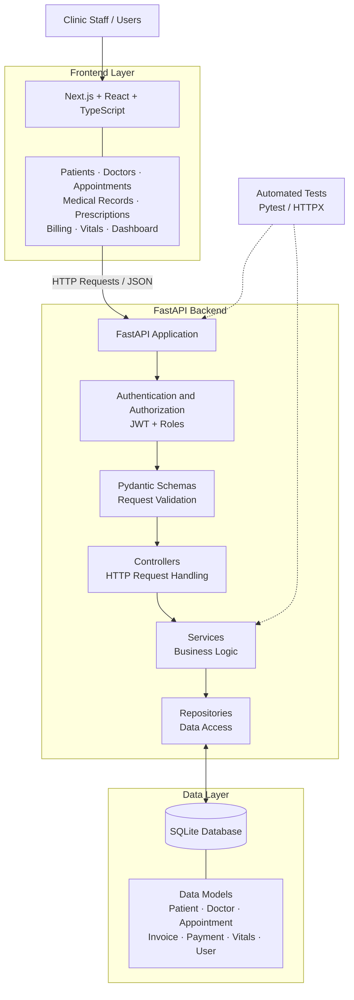
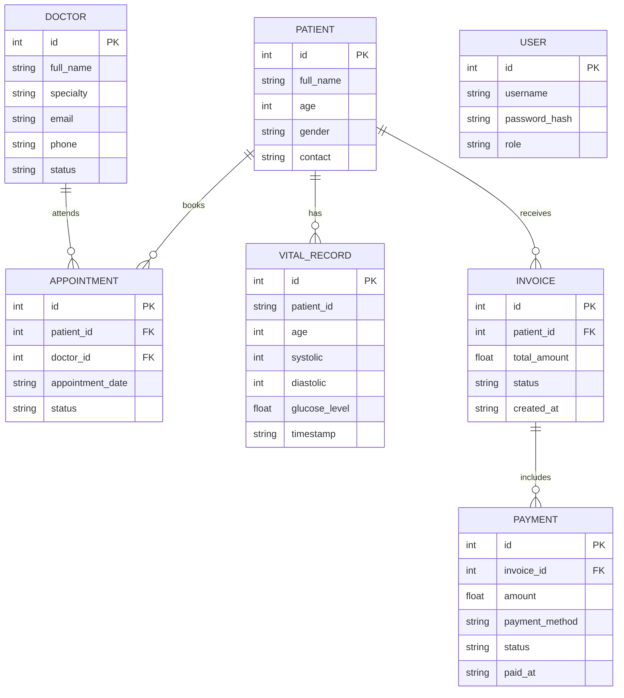

# Patient Management System


A full-stack clinic management application built with FastAPI, Next.js, React, TypeScript, and SQLite. It provides a foundation for managing patient records, doctors, appointments, invoices, billing, payments, authentication, and patient health metrics.

## Table of Contents

- [Project Overview](#project-overview)
- [Features and Modules](#features-and-modules)
- [Technology Stack](#technology-stack)
- [System Architecture](#system-architecture)
- [Database Schema Diagram](#database-schema-diagram)
- [Project Structure](#project-structure)
- [Installation and Setup](#installation-and-setup)
- [API Documentation](#api-documentation)
- [Patient Vitals API](#patient-vitals-api)
- [Testing](#testing)
- [Development Workflow](#development-workflow)
- [Future Improvements](#future-improvements)
- [Author](#author)

## Project Overview

The Patient Management System is designed to organize common clinic operations through a web application and REST API.

The backend uses FastAPI and a layered architecture inspired by MVC. It separates request handling, validation, business logic, data access, and database operations.

The frontend is built with Next.js, React, and TypeScript. It provides reusable components and interfaces for patient management and other clinic workflows.

The project also includes a patient health metrics API designed to receive, validate, store, retrieve, and summarize vital measurements.

## Features and Modules

### 1. Patient Management

- Create, retrieve, update, and delete patient records.
- Search and filter patient information.
- Paginate patient lists.
- View patient details.
- Export patient data to CSV.
- Connect the frontend patient directory to the backend API.

### 2. Doctor Management

- Manage doctor profile information.
- Store names, specialties, email addresses, phone numbers, and professional details where supported.
- Support doctor directory and profile interfaces.
- Provide a foundation for associating doctors with appointments.

### 3. Appointment Management

- Organize appointment information.
- Provide appointment forms, lists, filters, and status components.
- Include calendar-related frontend components.
- Support patient and doctor appointment workflows where backend integration is available.

### 4. Medical Records

- Provide medical record list and form components.
- Organize patient medical history.
- Provide a foundation for managing clinical information.

### 5. Prescriptions

- Provide prescription list, form, and details components.
- Include medication list components.
- Support future integration with patient medical records.

### 6. Billing and Invoices

- Organize billing information.
- Provide invoice forms, invoice lists, and invoice details.
- Include billing summary components.
- Support patient-related invoice workflows where implemented.

### 7. Payments

- Provide payment-related functionality and UI components.
- Organize payment information associated with invoices where supported.
- Support future expansion of payment tracking and reconciliation.

### 8. Patient Vitals and Health Metrics

- Provide a health-check endpoint.
- Accept patient vital measurements.
- Validate patient IDs, age, blood pressure, and glucose values.
- Store valid measurements.
- Retrieve historical vital records by patient ID.
- Calculate average systolic and diastolic blood pressure.
- Calculate average glucose level and total record count.

### 9. Authentication and Authorization

- JWT-based authentication.
- Password hashing using Argon2.
- Role-based access for admin, doctor, and receptionist.
- Protected API endpoints.
- Environment-based application configuration.

### 10. Dashboard and Analytics

- Dashboard and statistics components.
- Analytics and reporting component structures.
- Foundation for presenting clinic metrics and operational reports.

### 11. Laboratory and Pharmacy

- Laboratory-related frontend component structures.
- Pharmacy-related frontend component structures.
- Foundation for future clinical workflow integration.

> **Implementation status:** The project contains existing backend functionality and additional frontend component structures. A component folder does not automatically mean its module is fully integrated with the backend. Verify each module's routes, database operations, and end-to-end workflow before describing it as production-ready.

## Technology Stack

| Technology | Purpose |
|---|---|
| Python | Backend programming |
| FastAPI | REST API development |
| Pydantic | Request validation and schemas |
| SQLite | Relational data storage |
| Uvicorn | ASGI application server |
| Pytest | Automated testing |
| HTTPX | HTTP testing where configured |
| JWT | Authentication tokens |
| pwdlib with Argon2 | Password hashing |
| python-dotenv | Environment configuration |
| Next.js | Frontend framework |
| React | UI components |
| TypeScript | Type-safe frontend development |
| Tailwind CSS | Frontend styling |
| Git and GitHub | Version control |

## System Architecture

The system uses a layered structure to separate the user interface, API request handling, authentication, validation, business logic, database access, and testing.



### Architecture Components

**Frontend:** Provides screens and reusable components for clinic staff.

**FastAPI application:** Exposes HTTP endpoints and routes incoming requests.

**Authentication and authorization:** Verifies tokens and permissions for protected endpoints.

**Schemas:** Validate request data and define data structures.

**Controllers:** Handle HTTP requests and API responses.

**Services:** Contain application rules and coordinate operations.

**Repositories:** Handle database queries and persistence.

**SQLite database:** Stores application records.

**Automated tests:** Check API behavior and application logic.

The diagram describes the intended organization of the application. Individual endpoints may use a different request flow depending on their implementation.

## Database Schema Diagram

The following ER diagram illustrates the principal entities and their logical relationships in the clinic system.



### Database Entity Overview

| Entity | Purpose |
|---|---|
| Patient | Stores patient information |
| Doctor | Stores doctor profile information |
| Appointment | Represents a scheduled clinic visit |
| Vital Record | Stores patient health measurements |
| Invoice | Represents billing information |
| Payment | Records payments related to invoices |
| User | Represents an authenticated application account |

**Important:** This is a logical schema diagram. Field names, primary keys, foreign keys, and relationships must match the actual model definitions and database schema. For example, the vitals API may identify a patient using a string `patient_id`, while the main patient table may use an integer ID. Confirm how these identifiers are connected in the actual implementation.

## Project Structure

The following is a high-level overview of the repository. Update it if any directory names differ from the actual files.

```text
fastapi-patient-management-system/
│
├── backend/
│   ├── app/
│   │   ├── main.py
│   │   ├── auth/
│   │   │   ├── security.py
│   │   │   └── dependencies.py
│   │   ├── core/
│   │   │   ├── config.py
│   │   │   └── database/
│   │   │       └── connection.py
│   │   ├── database/
│   │   ├── models/
│   │   ├── schemas/
│   │   ├── repositories/
│   │   ├── services/
│   │   ├── controllers/
│   │   └── scripts/
│   │       └── create_admin.py
│   ├── requirements.txt
│   └── .env
│
├── frontend/
│   ├── src/
│   │   ├── app/
│   │   ├── components/
│   │   │   ├── auth/
│   │   │   ├── patients/
│   │   │   ├── doctors/
│   │   │   ├── appointments/
│   │   │   ├── medical-records/
│   │   │   ├── prescriptions/
│   │   │   ├── billing/
│   │   │   ├── laboratory/
│   │   │   ├── pharmacy/
│   │   │   └── analytics/
│   │   └── lib/
│   │       └── api.ts
│   ├── package.json
│   └── .env.local
│
├── tests/
├── .gitignore
└── README.md
```

### Backend Layer Responsibilities

- `main.py`: Creates the FastAPI application and registers routes.
- `auth/`: Contains authentication and authorization logic.
- `core/`: Contains application configuration and database connection setup.
- `models/` and `database/`: Organize data models and database-related code.
- `schemas/`: Define request and response data structures.
- `controllers/`: Handle API endpoints.
- `services/`: Implement business logic.
- `repositories/`: Handle database access.
- `scripts/`: Contains utility scripts, such as creating an administrator account.
- `tests/`: Contains automated tests.

## Installation and Setup

### Prerequisites

- Python 3.13 or a compatible version.
- Node.js and npm.
- Git.

### 1. Clone the Repository

```bash
git clone https://github.com/behra527/fastapi-patient-management-system.git
cd fastapi-patient-management-system
```

### 2. Set Up the Backend

Create and activate a virtual environment using Windows PowerShell:

```powershell
python -m venv .venv
.\.venv\Scripts\Activate.ps1
```

Install backend dependencies:

```powershell
python -m pip install -r .\backend\requirements.txt
```

Configure the required environment variables in `backend/.env`. Use a secure JWT secret and do not commit real credentials.

Start the backend from the repository root:

```powershell
python -m uvicorn app.main:app --app-dir .\backend --reload
```

The API should be available at:

`http://127.0.0.1:8000`

### 3. Set Up the Frontend

Open a second terminal:

```powershell
cd frontend
npm install
```

Configure the API base URL using the environment variable expected by `frontend/src/lib/api.ts`. For example, if the frontend uses `NEXT_PUBLIC_API_URL`:

```env
NEXT_PUBLIC_API_URL=http://127.0.0.1:8000
```

Start the frontend:

```powershell
npm run dev
```

Open:

`http://localhost:3000`

## API Documentation

FastAPI provides interactive API documentation:

- Swagger UI: http://127.0.0.1:8000/docs
- ReDoc: http://127.0.0.1:8000/redoc

Use Swagger UI to inspect the routes, request schemas, response formats, and available operations in the running application.

## Patient Vitals API

The health-metrics API is intended to receive, validate, store, and summarize patient vital measurements.

### Endpoint Summary

| Method | Endpoint | Purpose |
|---|---|---|
| GET | `/health` | Return service status and UTC timestamp |
| POST | `/vitals` | Submit a patient vital record |
| GET | `/patients/{patient_id}/vitals` | Retrieve historical vital records |
| GET | `/patients/{patient_id}/summary` | Summarize patient health metrics |

Check Swagger UI to confirm the routes are registered in the current build.

### 1. Health Check

```http
GET /health
```

Example response:

```json
{
  "status": "ok",
  "timestamp": "2026-10-22T00:00:00Z"
}
```

The timestamp is illustrative; the API should return the actual current UTC timestamp.

### 2. Submit Patient Vitals

```http
POST /vitals
Content-Type: application/json
```

Example request:

```json
{
  "patient_id": "P1001",
  "age": 35,
  "blood_pressure": {
    "systolic": 120,
    "diastolic": 80
  },
  "glucose_level": 95.5
}
```

### Validation Rules

| Field | Validation |
|---|---|
| `patient_id` | Required, non-empty string |
| `age` | Integer from 0 to 120 |
| `blood_pressure.systolic` | Integer from 50 to 300 |
| `blood_pressure.diastolic` | Integer from 30 to 200 |
| `glucose_level` | Numeric value greater than zero |

Invalid submissions should return descriptive HTTP `400 Bad Request` responses according to the task requirements. Verify that the application handles both custom validation failures and framework-generated request validation errors as required.

### 3. Retrieve Patient Vitals

```http
GET /patients/P1001/vitals?limit=10
```

This endpoint is intended to return historical measurements for the selected patient. The optional `limit` parameter controls how many records are returned.

### 4. Retrieve Patient Summary

```http
GET /patients/P1001/summary
```

The intended summary includes:

- Average systolic blood pressure.
- Average diastolic blood pressure.
- Average glucose level.
- Total number of stored records.

The response format and behavior for a patient with no records should follow the implemented API contract.

## Testing

Run the backend tests from the repository root:

```powershell
python -m pytest .\backend -v
```

If tests also exist in the root `tests/` directory, include that directory in the command or run it separately.

### Recommended Test Coverage

- Valid patient and vitals submissions.
- Missing or empty patient IDs.
- Age outside the allowed range.
- Systolic and diastolic values outside their allowed ranges.
- Invalid glucose values.
- Incorrect JSON data types.
- Vitals history retrieval.
- Summary calculations and record counts.
- Patient and doctor operations.
- Appointment, invoice, and payment workflows.
- Authentication and role-based access.
- Database operations and error handling.

Publish a test count or coverage percentage only after running the current code and obtaining the actual result.

## Development Workflow

1. Define the requirements and API contract.
2. Create data schemas and validation rules.
3. Implement controllers and services.
4. Add repository and database operations.
5. Connect frontend components to backend endpoints.
6. Write unit and integration tests.
7. Verify endpoints through Swagger UI.
8. Commit and push changes using Git.

## Future Improvements

- Complete remaining frontend-to-backend integrations.
- Expand appointment scheduling and calendar workflows.
- Complete medical records and prescription workflows.
- Improve billing reports and payment reconciliation.
- Add database migrations and stronger relational constraints.
- Add continuous integration with GitHub Actions.
- Prepare secure deployment and production configuration.

