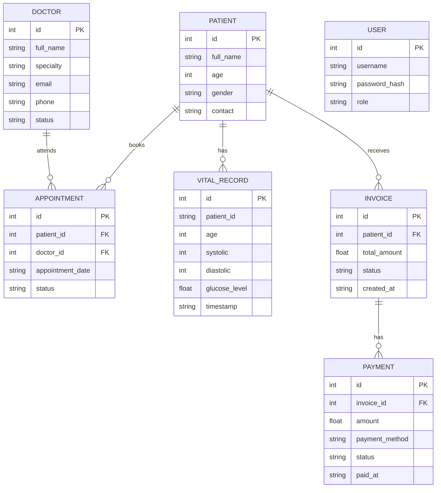

# Patient Management System


A full-stack clinic management application built with FastAPI, Next.js, React, TypeScript, and SQLite. The project brings together patient records, doctor management, appointments, billing, invoices, payments, authentication, and patient health metrics through a REST API.

## Table of Contents

- [Project Overview](#project-overview)
- [Features and Modules](#features-and-modules)
- [Technology Stack](#technology-stack)
- [Database Schema Diagram](#database-schema-diagram)
- [Project Structure](#project-structure)
- [Installation and Setup](#installation-and-setup)
- [API Endpoints](#api-endpoints)
- [Patient Vitals API](#patient-vitals-api)
- [Testing](#testing)
- [Development Workflow](#development-workflow)
- [Future Improvements](#future-improvements)
- [Author](#author)

## Project Overview

The Patient Management System is designed to organize common clinic operations in one application. It addresses the need to manage patient information, doctors, appointments, billing records, payments, and health measurements through a structured backend and web interface.

The backend is developed using FastAPI and follows a layered, MVC-inspired code organization. Controllers handle HTTP requests, schemas validate data, services implement business rules, and repositories manage data access.

The Next.js frontend provides the user interface and communicates with the backend through HTTP requests.

The project also includes a patient vitals API for accepting, validating, storing, retrieving, and summarizing health measurements.

## Features and Modules

### 1. Patient Management

- Create and manage patient records.
- Retrieve patient details.
- Update and delete patient information.
- Search and filter the patient directory.
- Paginate patient lists.
- Export patient records to CSV.

### 2. Doctor Management

- Manage doctor information.
- Store doctor names and professional details.
- Organize doctor records for clinic operations.
- Provide a foundation for linking doctors to appointments.

### 3. Appointment Management

- Create and retrieve appointments.
- Associate appointments with relevant patient and doctor records where supported.
- Manage appointment information and status.
- Support appointment-related API workflows.

### 4. Billing and Invoices

- Manage billing-related information.
- Create and retrieve invoice records.
- Associate invoices with patients where supported.
- Organize invoice information for clinic financial workflows.

### 5. Payments

- Manage payment records.
- Store payment-related information.
- Support invoice and payment workflows.
- Provide a foundation for tracking payment status.

### 6. Patient Vitals and Health Metrics

- Check API health and service status.
- Accept patient vital measurements.
- Validate patient IDs, age, blood pressure, and glucose values.
- Store valid health records.
- Retrieve a patient's historical vitals.
- Calculate average blood pressure and glucose measurements.
- Return the total number of records in a patient's summary.

### 7. Authentication and Authorization

- JWT-based login authentication.
- Password hashing using Argon2.
- Role-based access for admin, doctor, and receptionist.
- Protected API endpoints.
- Environment-based configuration for secrets and application settings.

### 8. Additional Frontend Components

The frontend component structure also includes the following clinic-related areas:

| Module | Component responsibilities |
|---|---|
| Dashboard and Analytics | Overview cards, metrics, and reports |
| Doctors | Doctor list, form, profile, and availability |
| Appointments | Appointment list, form, filters, status, and calendar |
| Medical Records | Record list, forms, and medical history |
| Prescriptions | Prescription list, form, details, and medication list |
| Billing | Billing summary and invoice screens |
| Payments | Payment form and related payment workflows |
| Laboratory | Laboratory-related interface components |
| Pharmacy | Pharmacy-related interface components |
| Layout | Sidebar, header, and shared application UI |
| Patients | Patient directory, form, details, filters, and pagination |
| Authentication | Login and session-related UI |

**Implementation note:** Backend API modules have been manually exercised, including patient, doctor, vitals, authentication, appointments, billing/invoices, and payments. Additional frontend components should not be assumed to have complete backend integration unless their end-to-end workflows have been verified.

## Technology Stack

| Technology | Purpose |
|---|---|
| Python | Backend programming |
| FastAPI | REST API development |
| Pydantic | Request and data validation |
| SQLite | Relational database |
| Uvicorn | ASGI server |
| Pytest | Automated testing |
| HTTPX | HTTP testing where configured |
| JWT | Token-based authentication |
| pwdlib / Argon2 | Password hashing |
| python-dotenv | Environment variable loading |
| Next.js | Frontend framework |
| React | User interface |
| TypeScript | Type-safe frontend development |
| Tailwind CSS | Frontend styling |
| Git and GitHub | Version control and collaboration |

## Database Schema Diagram

The following ER diagram shows the main logical entities of the clinic system and their intended relationships.



### Entity Descriptions

- **Patient:** Stores patient demographic and contact information.
- **Doctor:** Stores doctor profile and professional information.
- **Appointment:** Represents a scheduled patient visit and its doctor association.
- **Vital Record:** Stores a patient's blood pressure, glucose level, age, and measurement timestamp.
- **Invoice:** Represents a billing document associated with a patient.
- **Payment:** Records payment information associated with an invoice.
- **User:** Represents an authenticated application account and its access role.

The diagram represents the logical data model, not a guarantee that every displayed field, foreign-key constraint, or relationship exactly matches the current SQLite schema. The actual model and migration definitions should be treated as the source of truth. The `USER` entity is included to document authentication conceptually.

## Project Structure

```text
fastapi-patient-management-system/
│
├── backend/
│   ├── app/
│   │   ├── main.py
│   │   │
│   │   ├── auth/
│   │   │   ├── security.py
│   │   │   └── dependencies.py
│   │   │
│   │   ├── core/
│   │   │   ├── config.py
│   │   │   └── database/
│   │   │       └── connection.py
│   │   │
│   │   ├── database/
│   │   ├── models/
│   │   ├── schemas/
│   │   ├── repositories/
│   │   ├── services/
│   │   ├── controllers/
│   │   └── scripts/
│   │       └── create_admin.py
│   │
│   ├── requirements.txt
│   └── .env
│
├── frontend/
│   ├── src/
│   │   ├── app/
│   │   ├── components/
│   │   │   ├── auth/
│   │   │   ├── patients/
│   │   │   ├── doctors/
│   │   │   ├── appointments/
│   │   │   ├── medical-records/
│   │   │   ├── prescriptions/
│   │   │   ├── billing/
│   │   │   ├── laboratory/
│   │   │   ├── pharmacy/
│   │   │   └── analytics/
│   │   └── lib/
│   │       └── api.ts
│   ├── package.json
│   └── .env.local
│
├── tests/
├── .gitignore
└── README.md
```

The structure above is a directory overview. Some folders may contain additional files, and exact names should be aligned with the repository's current contents.

## Installation and Setup

### Prerequisites

- Python 3.13 or a compatible version.
- Node.js and npm.
- Git.

### 1. Clone the Repository

```bash
git clone https://github.com/behra527/fastapi-patient-management-system.git
cd fastapi-patient-management-system
```

### 2. Set Up the Backend

Create and activate a virtual environment on Windows PowerShell:

```powershell
python -m venv .venv
.\.venv\Scripts\Activate.ps1
```

Install dependencies:

```powershell
python -m pip install -r .\backend\requirements.txt
```

Configure the required environment variables in `backend/.env`. Use a secure JWT secret and do not commit real secrets to GitHub.

Start the API from the repository root:

```powershell
python -m uvicorn app.main:app --app-dir .\backend --reload
```

Backend base URL:

`http://127.0.0.1:8000`

### 3. Set Up the Frontend

Open a second terminal:

```powershell
cd frontend
npm install
```

Configure the frontend API URL using the environment variable expected by `src/lib/api.ts`. For example, if the frontend uses `NEXT_PUBLIC_API_URL`:

```env
NEXT_PUBLIC_API_URL=http://127.0.0.1:8000
```

Start the frontend:

```powershell
npm run dev
```

Open:

`http://localhost:3000`

## API Endpoints

The following health-metrics routes describe the required API contract. Check the live Swagger documentation for the exact routes registered in the current build.

| Method | Endpoint | Purpose |
|---|---|---|
| GET | `/health` | Health status and UTC timestamp |
| POST | `/vitals` | Submit and validate patient vitals |
| GET | `/patients/{patient_id}/vitals` | Retrieve patient vitals history |
| GET | `/patients/{patient_id}/summary` | Summarize patient health metrics |

The system also provides patient, doctor, appointment, invoice, payment, and authentication API functionality. Consult Swagger UI for the exact route paths and request schemas.

### Interactive API Documentation

- Swagger UI: http://127.0.0.1:8000/docs
- ReDoc: http://127.0.0.1:8000/redoc

## Patient Vitals API

### Submit Vitals

Example request:

```http
POST /vitals
Content-Type: application/json
```

```json
{
  "patient_id": "P1001",
  "age": 35,
  "blood_pressure": {
    "systolic": 120,
    "diastolic": 80
  },
  "glucose_level": 95.5
}
```

### Validation Rules

| Field | Requirement |
|---|---|
| `patient_id` | Required, non-empty string |
| `age` | Integer between 0 and 120 |
| `blood_pressure.systolic` | Integer between 50 and 300 |
| `blood_pressure.diastolic` | Integer between 30 and 200 |
| `glucose_level` | Numeric value greater than zero |

Invalid values should return descriptive HTTP `400 Bad Request` responses according to the task specification. Confirm that the current validation handler converts framework validation errors to HTTP 400 where required.

### Retrieve Vitals History

```http
GET /patients/P1001/vitals?limit=10
```

Returns historical records for the selected patient, subject to the API's implemented response format and limit handling.

### Retrieve Patient Summary

```http
GET /patients/P1001/summary
```

The intended summary includes average systolic pressure, average diastolic pressure, average glucose level, and total record count.

## Testing

Run the backend tests from the repository root:

```powershell
python -m pytest .\backend -v
```

Test cases should cover:

- Valid requests and stored records.
- Missing and empty patient IDs.
- Age and blood-pressure boundary violations.
- Invalid glucose values.
- Incorrect JSON data types.
- Vitals history retrieval.
- Summary averages and record counts.
- Patient, doctor, appointment, invoice, and payment workflows.
- Authentication and role-based access.
- Database and API error handling.

Only report the latest test count after running the current test suite.

## Development Workflow

1. Define requirements and endpoint contracts.
2. Create schemas and validation rules.
3. Implement controllers and service logic.
4. Add repository and database operations.
5. Connect frontend components to the API.
6. Write unit and integration tests.
7. Verify API behavior using Swagger UI.
8. Track changes using Git and GitHub.

## Future Improvements

- Complete integration of remaining frontend modules.
- Expand appointment scheduling and calendar workflows.
- Improve medical history and prescription management.
- Add detailed billing reports and payment reconciliation.
- Strengthen database relationships and migration management.
- Add CI workflows with GitHub Actions.
- Prepare secure deployment and production configuration.


This project is intended for software engineering practice. Production use with real patient data requires appropriate security, privacy, access controls, backup procedures, and compliance review.
